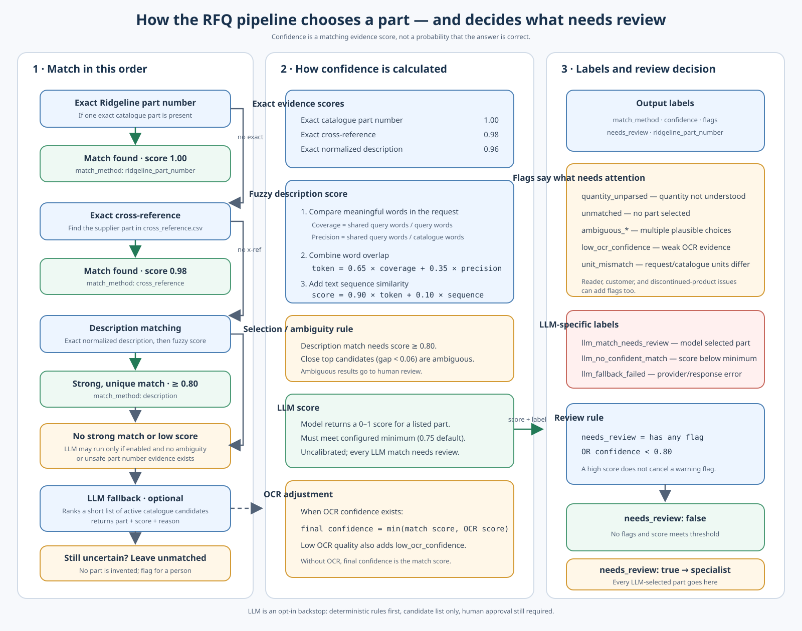
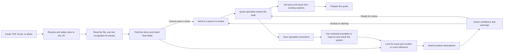

# Ridgeline Quote Desk

This project turns customer requests for quotes (RFQs) into draft line items. A quote specialist checks every draft before a quote is prepared.

## Repository

Public GitHub link: https://github.com/dakshgateway98/ridgeline-quote-desk-data-pack


## How to Run

You need Python 3.9 or newer. Install the optional Python readers with:

```bash
python3 -m pip install -r requirements.txt
```

PDF text extraction uses `pypdf`. Scanned PDFs also need Poppler (`pdftoppm`) and Tesseract OCR; images need Tesseract. On macOS, install them with `python3 -m pip install --user 'pypdf>=5,<7'` and `brew install poppler tesseract`. Legacy Word/Excel conversion uses LibreOffice. If a reader is missing, the RFQ still gets a reviewable output with the reason.

```bash
python3 pipeline.py
python3 evaluate.py
python3 -m unittest discover -v
python3 check_submission.py
```

- `pipeline.py` reads the six sample RFQs and writes one draft for each to `outputs/`.
- `evaluate.py` compares the drafts with the three supplied answer files. It writes the scores to `evaluation/results.json`.
- `check_submission.py` checks the submission files and creates a zip file.

The pipeline does not read the answer files. Only `evaluate.py` reads them.

## Approach

Readers are separate functions in `document_readers.py`. The pipeline supports text and HTML email, CSV/TSV, JSON, all worksheets in XLSX, DOCX paragraphs and tables, HTML, digitally generated and scanned PDFs, and common image files. It can also use LibreOffice for legacy Word/Excel files and `extract-msg` for Outlook messages. Email attachments are passed through the same readers, including PDF, spreadsheet, Word, and image attachments.

PDF text is read first. If it is too short or empty, the reader rasterizes the pages and tries OCR. OCR confidence and low-quality results are recorded as review flags. Excel worksheet names are included in line notes. Repeated or conflicting headers, merged cells, empty rows, notes, and multi-line item descriptions are handled without inventing missing values.

For each line, the pipeline tries to find a part in this order:

1. An exact Ridgeline part number.
2. A part number from the cross-reference sheet.
3. A match based on the product description.

It keeps the original words, worksheet/table source, and unparsed content. OCR confidence, duplicate spreadsheet columns, attachment errors, and uncertain lines are marked for a person to check rather than being hidden.

The pipeline uses general rules and catalog data; it has no customer-specific part aliases or source-file names. Data locations, unit aliases, extraction limits, matching weights, and review thresholds are set in `pipeline_config.json`. Its match order is exact catalogue part, exact cross-reference, exact normalized description, then weighted token/fuzzy description. Similar candidates are sent for review. Scores describe matching evidence; they are not calibrated probabilities. The pipeline does not use an AI model, make up prices or stock information, or send quotes to customers. A person must approve every quote.

Most settings are grouped by purpose in `pipeline_config.json`: `matching` controls evidence scores and fuzzy-match weights, `ocr` controls text quality thresholds, language, resolution, and timeout, and `processing_limits` controls file sizes, page counts, and attachment depth. `supported_units` and `unit_aliases` define accepted units. The optional LLM fallback is disabled by default. To enable it, set `matching.llm.enabled` to `true`, configure an OpenAI-compatible chat-completions endpoint and model, and set the configured API-key environment variable (default: `LLM_API_KEY`). The model only runs after deterministic matching abstains, receives a bounded list of catalogue candidates, and must return one of those part numbers. Every LLM-selected line receives `match_method: "llm"` and the `llm_match_needs_review` flag; scores are uncalibrated evidence and require human review. Provider failures and invalid outputs are flagged without guessing.

The main code is grouped by its job:

- `readers/` reads document files. `document_readers.py` remains as a small compatibility import for older scripts.
- `extractors/` turns tables and free text into line items.
- `matching/` checks exact part numbers, cross-references, and product descriptions.
- `models/` checks the output shape with a small dependency-free schema validator.
- `services/` connects reading, extraction, matching, and customer lookup for each RFQ.
- `evaluation/metrics.py` calculates evaluation scores; `evaluate.py` is the command-line runner.
- `pipeline.py` runs a batch, and `tests/` checks each part and the whole flow.



No one program can read every possible document format. Add a reader for a new format in `read_source`, and send any file it cannot read to a person. Product matching uses the parts and cross-references in the data files, so those files need to be current.

## Evaluation

The evaluation uses only the three RFQs that have answer files. It reports exact extraction accuracy, match precision and recall, customer identification rate, review rate, false positives and false negatives. It also compares several confidence thresholds and reports a recommendation only when a threshold meets the configured precision target. Run `python3 evaluate.py` after generating drafts to refresh `evaluation/results.json`.

The answer set is small. Scores on these files do not show how well the pipeline will work on new customer requests, and should not be treated as a guarantee.

The review threshold is `0.80`. A line below this confidence is sent to a person. Lines with a warning, such as an unknown part or missing quantity, also need review even when confidence is higher. To improve the evaluation, label more old RFQs and the final parts chosen by specialists. Include different document types, unclear requests, and products that look similar. Use some of those examples for checking the system, not for tuning it.

## Production

This diagram shows how a full system could work:



- **If reading fails or a new file type arrives:** show why it needs help and send it to a person. Add support for the new file type after checking examples.
- **What to watch:** how often reading or matching fails, how many lines people correct, how long reviews take, and how long the system takes. Alert the team if these numbers suddenly get worse.
- **Cost and speed:** this sample runs on your computer and does not use a paid model. As a rough starting estimate, a hosted document reader and small AI model might cost less than 5 cents per RFQ and take 2–10 seconds. Check real prices and test with actual documents before choosing a service.
- **Using corrections:** save the changes specialists make and why they made them. Review those examples before using them to improve the product search or document reader.
- **If there were two more weeks:** collect more labeled RFQs, add a reliable document reader and product search, test with similar-looking products, then try the system with a small group of specialists.
